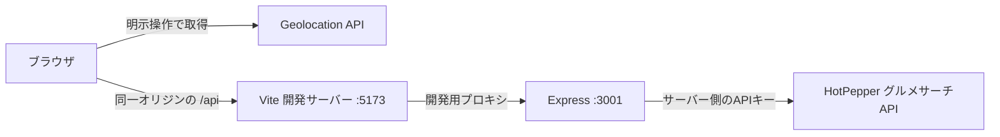

# ちかめし（chikameshi）

現在地と検索半径から、近くの飲食店を探すWebアプリです。フェンリルのウェブアプリ選考課題として、外部APIの情報を安全に取得し、検索から詳細確認まで迷わず操作できることを目指しています。

機能・設計・動作確認環境をまとめた簡易仕様書を用意しています：[Markdown版](docs/簡易仕様書.md) ／ [PDF版](docs/簡易仕様書.pdf)。

## 機能

- Geolocation APIによる現在地取得と、許可拒否・取得失敗・タイムアウトからの再試行
- 半径300m・500m・1km・2km・3kmでのHotPepperグルメサーチ
- 店名・アクセス・画像を含む店舗一覧、12件ずつのページングと表示件数
- 店名・住所・営業時間・画像などの詳細、地図・HotPepperへの外部リンク
- 検索範囲の変更、検索0件・ページ範囲外・通信失敗からの復帰
- ブラウザの戻る・進む、一覧と詳細の往復時のスクロール復元
- キーボード操作、本文への移動リンク、画面タイトル・フォーカス管理

お気に入り・認証・DBへの保存は実装していません。架空の店舗データへのフォールバックも行いません。

## 技術スタック

`package-lock.json` に固定された主なバージョンです。実際のインストール結果は `npm ls --workspaces --depth=0` で確認できます。

| 用途 | 技術・バージョン |
| --- | --- |
| UI | React / React DOM 18.3.1 |
| 言語 | TypeScript 5.7.3（strict） |
| 開発・ビルド | Vite 6.4.6 |
| スタイル | Tailwind CSS 4.3.5、Lucide React 0.468.0 |
| APIサーバー | Express 4.22.3、dotenv 16.6.1 |
| フロントテスト | Vitest 4.1.12、Testing Library、jsdom 26.1.0 |
| バックテスト | Node.js標準テストランナー、tsx 4.23.15 |

Reactで画面状態を管理し、通信・現在地取得は小さなHookに分けています。バックエンドを置くことでAPIキーをブラウザへ渡さず、外部APIのデータ検証とエラー分類を集約しています。追加の状態管理・HTTP通信ライブラリは使用していません。

## システム構成



Reactが画面と検索セッションを管理し、Expressが外部APIへの通信を担当します。DBはありません。上のプロキシは開発用です。本番配信では別途、静的ファイル配信・SPAのパス書き換え・`/api` の接続・HTTPSを設定してください。

## ディレクトリ構成

```text
chikameshi/
├── .github/workflows/ci.yml      # 型・ビルド・テスト・監査
├── backend/
│   ├── scripts/test.mjs          # テストを再帰的に探索して実行
│   └── src/
│       ├── app.ts               # Expressアプリと共通エラー処理
│       ├── index.ts             # .env読込と起動
│       ├── routes/shops.ts      # 入力検証と検索・詳細のHTTP API
│       ├── services/            # 上流API通信・検証とテスト
│       └── types/               # サーバー側の型・エラー定義
├── frontend/src/
│   ├── components/              # 共通の表示部品
│   ├── hooks/                   # 通信状態・現在地・アクセシビリティ
│   ├── pages/                   # Home / Results / Detail
│   ├── services/                # HTTP通信・データ検証・表示補助
│   ├── types/                   # 店舗・検索条件の型
│   ├── test/setup.ts            # テスト後の後片付け
│   ├── App.tsx                 # 画面遷移・検索セッション・スクロール
│   └── main.tsx                # React起動
├── .env.example
├── .nvmrc
├── package.json                 # npm workspacesと共通コマンド
└── package-lock.json
```

## 開発環境の構築

Node.js 22系とnpmを用意してください。`.nvmrc` は22を指定しています。CIには22・24系の検証を設定しています。nvm利用時は `nvm install`、`nvm use` で切り替えられます。

```sh
git clone --branch develop https://github.com/y-haruki05/chikameshi.git
cd chikameshi
npm ci
cp -n .env.example .env
```

既に `.env` がある場合はコピーせず、そのファイルを編集してください。

### APIキーの取得と設定

1. [リクルートWEBサービス](https://webservice.recruit.co.jp/)から[APIキー発行登録](https://webservice.recruit.co.jp/register)へ進み、案内に従ってキーを取得します。
2. プロジェクト直下の `.env` に `HOTPEPPER_API_KEY` を設定します。キーはこのファイルかサーバーの環境変数にのみ設定してください。
3. `git check-ignore .env` が `.env` を返し、Git管理対象外であることを確認します。

```dotenv
HOTPEPPER_API_KEY=取得したキーをここに設定
PORT=3001
HOTPEPPER_API_TIMEOUT_MS=5000
```

| 環境変数 | 用途・既定値 |
| --- | --- |
| `HOTPEPPER_API_KEY` | 必須。未設定時は店舗APIが503を返す（ヘルスチェックは利用可能） |
| `PORT` | バックエンドのポート。既定値3001。変更時は `frontend/vite.config.ts` のプロキシ接続先も合わせる |
| `HOTPEPPER_API_TIMEOUT_MS` | 上流APIのタイムアウト。既定値5000ms、1000〜30000msに制限 |

サーバーに設定した環境変数は `.env` より優先されます。キーの変更後はバックエンドを再起動してください。`VITE_` 付き変数にAPIキーを設定するとブラウザへ公開されるため使用しないでください。

### 起動

プロジェクト直下で実行します。

```sh
npm run dev
```

- フロント：`http://localhost:5173`（使用中の場合は起動ログのURLを確認）
- バック：`http://localhost:3001`
- 終了：起動したターミナルで `Ctrl+C`

Homeで検索範囲を選び、「現在地を取得」を押して位置情報を許可した後、「この条件でお店を探す」を押します。LAN内のスマートフォンからHTTPで開いても位置情報取得は使えません。実端末ではHTTPS環境を用意してください。

### 接続確認・困ったとき

```sh
curl http://localhost:3001/api/health
# {"status":"ok"}
```

キー設定後、公開場所の例示座標で接続確認できます。実際の現在地を共有する必要はありません。

```sh
curl 'http://localhost:3001/api/shops?lat=35.66&lng=139.70&range=3&start=1&count=12'
```

| 状況 | 確認すること |
| --- | --- |
| 503 / `HOTPEPPER_API_KEY_MISSING` | ルートの.env・サーバー環境変数・再起動 |
| 502 / 上流エラー | キーの有効性、ネットワーク、外部サービスの状態 |
| 504 / タイムアウト | 時間を置いて再試行。必要なら上流タイムアウト値を調整 |
| 現在地の取得失敗 | HTTPS/localhost、ブラウザとOSの権限・位置情報設定 |
| 画面からAPIに接続できない | 両サーバーの起動、PORTとプロキシの一致 |

## テスト・ビルド

```sh
npm run typecheck
npm run build
npm test
npm audit
git diff --check
```

個別に実行する場合は `npm test --workspace @chikameshi/frontend` または `npm test --workspace @chikameshi/backend` を使用します。バックエンドは `src` 配下の `.test.ts` を再帰的に探索するため、新しいテストをコマンドへ列挙する必要はありません。

テストは上流APIをモックするため、キーや位置情報権限なしで実行できます。テスト結果は実APIや実機での動作確認を代替しません。GitHub Actionsはpush・PRで同じ検証を実行します。設定を追加しただけではCIが成功したことにはならず、実行結果の確認が必要です。

`npm run build` は `frontend/dist` と `backend/dist` を生成します。`npm start --workspace @chikameshi/backend` でビルドしたAPIサーバーを起動できます。これはフロントの静的ファイルを配信するコマンドではありません。

## 通信・API仕様

- `GET /api/health`：サーバーの生存確認
- `GET /api/shops?lat=...&lng=...&range=...&start=...&count=...`：一覧。成功時は `{ data: { shops, pagination } }`
- `GET /api/shops/:id`：詳細。成功時は `{ data: shop }`、見つからない場合は404

`range` は1=300m、2=500m、3=1km、4=2km、5=3km。`start` は1始まり、`count` は1〜100件です。営業時間等も取得するため `type=lite` は指定しません。仕様は[公式リファレンス](https://webservice.recruit.co.jp/doc/hotpepper/reference.html)を参照してください。

HTTP 200でも上流のエラー本文を判定します。上流の `results_returned` は数値と数字のみの文字列を受け入れ、店舗ID・座標・件数・取得範囲の整合性は検証します。説明文の欠損は代替表示しますが、壊れた構造を店舗情報として表示しません。

ブラウザから自前APIへの通信は、本文の受信を含め35秒で打ち切ります。通信失敗・タイムアウト・APIエラー・形式不正を分類し、入力不正や404では解決しない再試行を表示しません。画面遷移時は中断し、古い応答を無効化します。同条件の再試行連打や取得中の再送も抑止します。

## セキュリティ・プライバシー

- キーはサーバー内でのみ使用し、応答・画面・例外ログへそのまま出しません。
- `.env` はGit管理対象外です。スクリーンショットや問い合わせにもキーを含めないでください。
- 現在地はメモリ内に保持し、画面URL・ブラウザ履歴・localStorage・sessionStorageへ保存しません。履歴には位置情報を含まない識別子だけを保持します。
- 検索時の座標は自前APIとHotPepper APIへ送信します。外部の画像・地図・店舗リンクを利用すると、その外部サービスへの通信が発生します。
- 店舗APIは `Cache-Control: no-store` とし、ブラウザ側もキャッシュを使いません。公開配信のアクセスログにも検索クエリを記録しないよう設定してください。
- 外部URLはHTTP/HTTPSのみに制限します。
- HotPepper APIの出典リンクと「画像提供：ホットペッパー グルメ」を共通フッターに表示します。提出資料の画面キャプチャは、架空の店舗情報と利用条件を確認したUnsplash写真で撮影しています。実API由来の店舗写真入りキャプチャは提出物・Git管理対象に含めません。実APIの動作確認結果と撮影用データは区別し、写真の作者・出典・ライセンスは簡易仕様書に記載しています。

## 既知の制約・確認事項

- 検索結果画面の再読み込み・共有では座標を復元せず、現在地の取得からやり直します。詳細URLは店舗IDだけで取得できます。
- 位置情報の履歴は最大20検索です。古い履歴では再取得が必要です。
- 取得済みの現在地は自動更新しません。移動後はHomeで取り直してください。
- DB・認証・お気に入り・アプリ内地図はありません。
- バックエンドにレート制限はありません。公開運用時はAPIの利用枠と公開範囲を確認してください。
- レスポンシブの実ブラウザ検証と実端末・スクリーンリーダー検証は区別して記録します。動作確認済みのOS・ブラウザと未確認環境は簡易仕様書に記載しています。

## 今回の検証記録（2026-11-25）

- ローカル環境：Node.js 24.6.0 / npm 11.5.1。型チェック・ビルド・フロント74件／バック42件のテストが成功。
- `npm audit` は脆弱性0件。実キーを含まない一時コピーでも `npm ci` と開発サーバーの起動を確認。
- Chrome 158.0.8127.38（headless）で幅320・375・768・1440pxを検証。検索・詳細・ページ変更・0件からの範囲変更・エラー復帰・キーボード操作・タイトルとフォーカス・戻る／進むとスクロール復元を確認。検査した状態で横はみ出しなし。
- axeによるHome・一覧・詳細・0件・エラーの計20状態のWCAG 2 A/AA・2.1 AA自動検査は違反0件。自動検査はアクセシビリティ全体の適合を保証するものではありません。
- ブラウザの店舗データ・画像・位置情報は検証用の固定値。ヘルスチェックとキー未設定の503は実際のローカルAPI経由で確認し、その後の正常系はAPIモックで検証しました。
- 上記の自動ブラウザ検証とは別に、設定済みのAPIキーを使った実HotPepper APIの疎通を確認し、店舗検索がHTTP 200で12件返ることを確認しました。利用者による実ブラウザでの操作確認も完了しています（MacBook Air／macOS／Chrome。手動確認時の正確なバージョンは未記録）。
- スマートフォン実機・Safari/Firefox・実スクリーンリーダーの確認は未実施です。
- 最新develop `8f3db66`の[GitHub Actions実行 #45457900997](https://github.com/y-haruki05/chikameshi/actions/runs/45457900997)は2026年11月25日03:18（日本時間）に成功。Node.js 22・24の両ジョブで、npm ci・型チェック・ビルド・全テスト・npm audit・差分チェックが成功しました。

CIの設定方法は[checkout](https://github.com/actions/checkout)・[setup-node](https://github.com/actions/setup-node)の公式資料に従っています。
