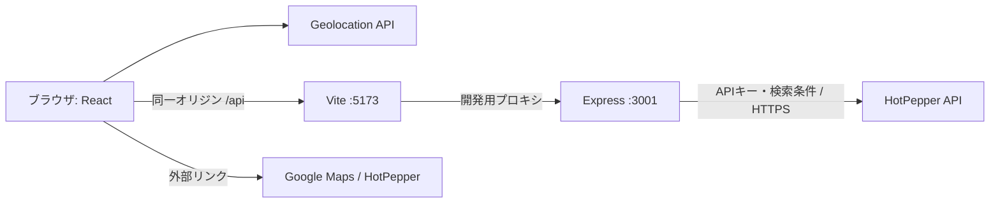
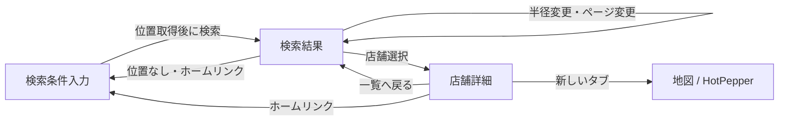
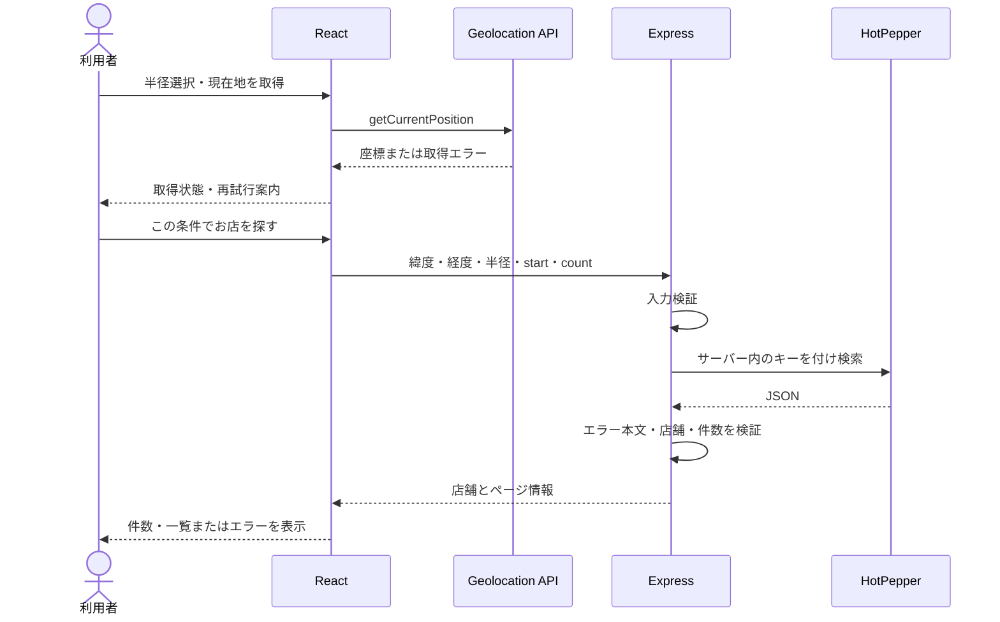
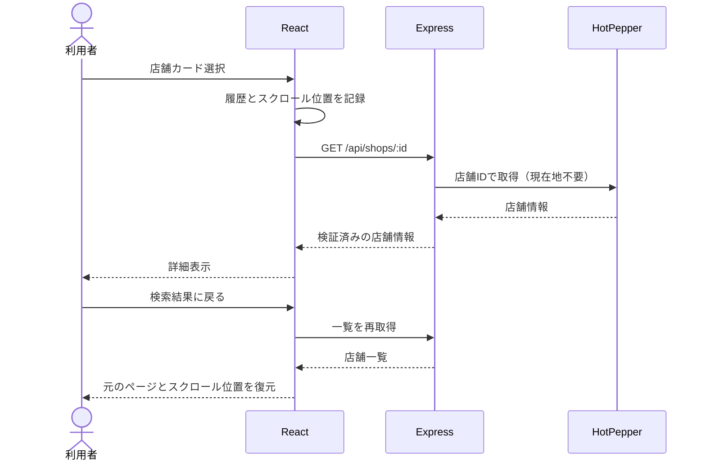
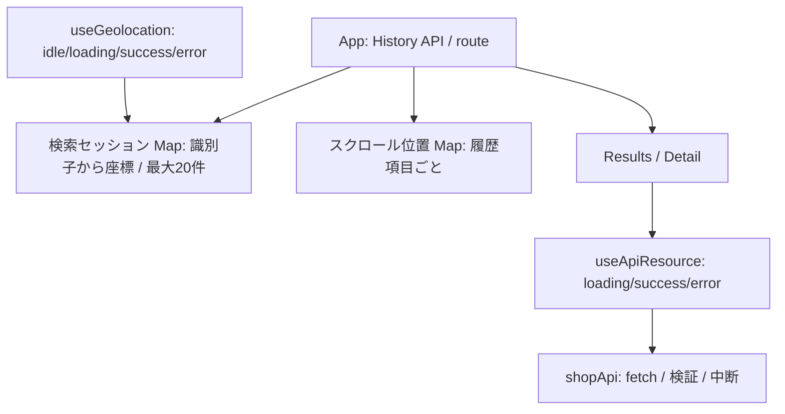
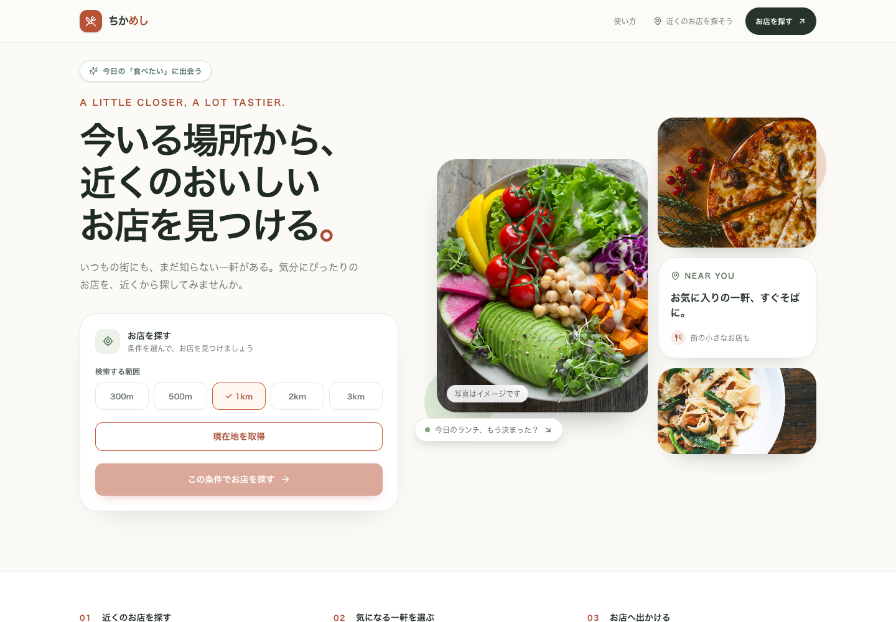
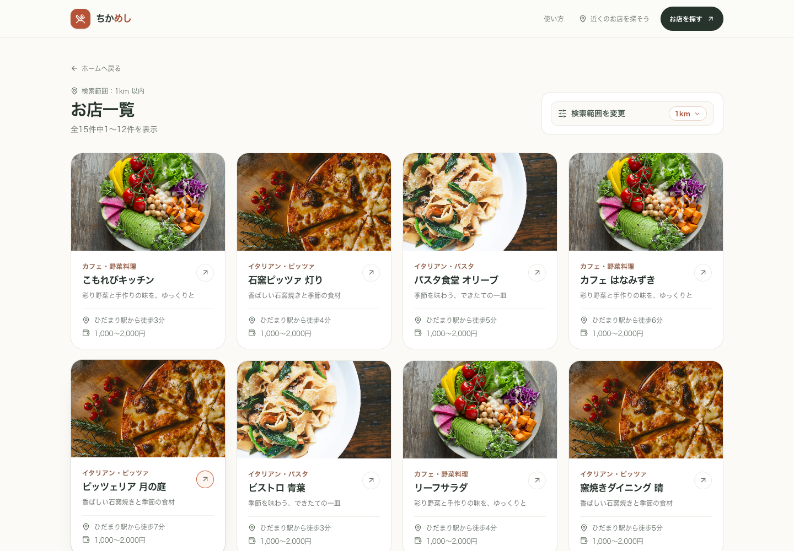
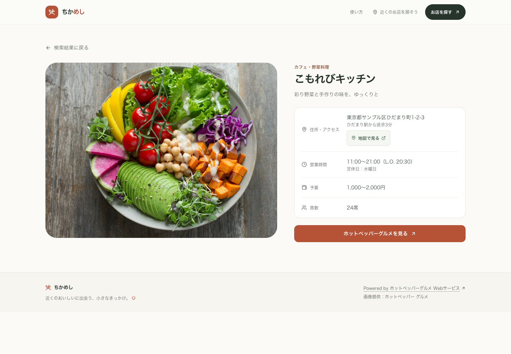
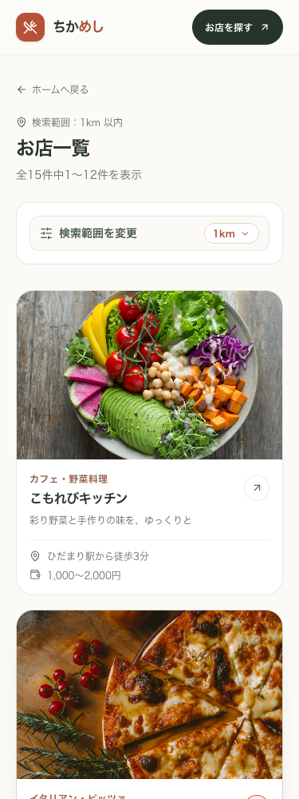
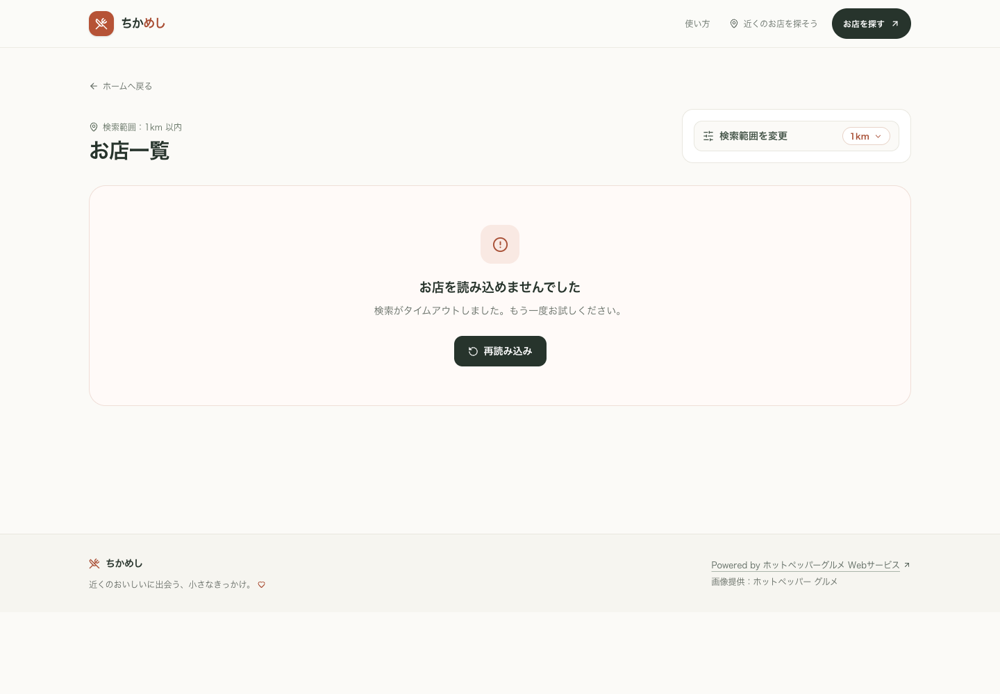

# ちかめし 簡易仕様書

フェンリル株式会社 2028年新卒採用・Webエンジニア選考課題\
作成日：2026年11月25日／参照実装：develop `8f3db66`（品質改善PR #13マージ後。提出準備時の画像クレジット修正を含む）

本書は、現在地付近の飲食店を検索するWebアプリ「ちかめし」の機能・設計・開発方法と検証結果をまとめたものである。課題原本「選考課題【ウェブアプリ】v20261101」で指定された14項目を第1〜14節に記載する。

## 1. アプリ名

**ちかめし（chikameshi）**\
リポジトリ：https://github.com/y-haruki05/chikameshi

## 2. 対象OS・ブラウザ

| 区分 | 環境・確認状況 |
| --- | --- |
| 動作確認対象 | macOS 15.7.9／Google Chrome 158.0.8127.38 |
| 開発・手動確認 | MacBook Air、macOS、Chrome。開発者が実ブラウザで操作し正常動作を確認。上記バージョンは本書作成時に端末から取得した値で、手動確認時の版は別途記録していない |
| 自動ブラウザ検証 | 同端末のChrome 158.0.8127.38をheadlessで使用。画面幅320・375・768・1440px |
| 未確認 | スマートフォン／タブレット実機、Windows、Android、iOS、Safari、Firefox、実スクリーンリーダー |

画面幅を変えた検証は実機での動作保証ではない。現在地取得にはGeolocation APIと利用許可、HTTPSまたはlocalhostが必要。検索にはインターネット接続と有効なHotPepper APIキーが必要。

## 3. 開発環境・言語

- 開発端末：MacBook Air／macOS 15.7.9（ビルド24G830）
- エディタ：Visual Studio Code 1.96.4（端末内のアプリ情報から取得）
- 言語：TypeScript 5.7.3、HTML、CSS。設定・テスト起動補助にはJavaScriptも使用
- 実行環境：Node.js 24.6.0、npm 11.5.1。`.nvmrc`はNode.js 22系を指定
- 管理：Git／GitHub、npm workspaces（frontend／backend）
- 生成AI：ChatGPT、Codex（モデル・サービスの正確な版は未記録。利用範囲は第7節）

## 4. 開発期間

**2026年11月18日〜11月25日（約1週間）**。Git履歴上の開発期間も同期間である。実作業時間は未計測であり、開発期間とは区別している。

| Git履歴上の日付（日本時間） | 主な作業 |
| --- | --- |
| 11月18日 | 初期構築・API基盤 |
| 11月19日 | UI・画面構成 |
| 11月21日 | 現在地取得 |
| 11月25日 | 実API検索、一覧・詳細のUX、名称変更、品質改善、本書の作成 |

## 5. 機能概要・機能一覧

現在地と検索半径から周辺の飲食店を探し、写真・アクセスを比較して詳細や地図を確認するWebアプリ。

| 画面 | 機能・表示 |
| --- | --- |
| 検索条件入力 `/` | 明示操作で現在地取得、半径300m／500m／1km／2km／3kmの選択（初期値1km）、許可拒否・取得失敗からの再試行 |
| 検索結果 `/search?range=3&page=1` | 店名・アクセス・サムネイル・ジャンル・予算、総件数と表示範囲、12件ずつのページング、範囲変更、詳細への遷移 |
| 店舗詳細 `/shop/:id` | 店名・住所・アクセス・営業時間・定休日・画像・ジャンル・予算・席数、Google MapsとHotPepperへの外部リンク |
| 共通 | ローディング・エラー・0件・ページ範囲外・欠損情報への対応、戻る／進む、一覧のスクロール復元、画面タイトル・キーボード操作への配慮 |

### 課題の必須機能との対応

| 課題原本1ページの要求 | 実装・根拠 | 状況 |
| --- | --- | --- |
| 指定言語を使用 | TypeScript（前後両方） | 実装済み |
| HotPepperグルメサーチAPIで現在地付近を検索 | `hotpepperService.ts`で緯度・経度・rangeを送信 | 実装済み・実API疎通済み |
| Geolocation APIで現在地取得 | `useGeolocation.ts` | 実装済み |
| 検索半径を指定 | `SearchCondition.tsx`の5段階選択 | 実装済み |
| 検索結果を一覧表示 | `ResultsPage.tsx`／`ShopCard.tsx` | 実装済み |
| 一覧：店舗名称・アクセス・サムネイル画像 | 店名、access、photo。欠損時は代替文・画像プレースホルダー | 実装済み（データの有無はAPIに依存） |
| ページング | 12件、`start=(page-1)*12+1` | 実装済み |
| 一覧で選択した店舗を詳細表示 | 店舗IDから詳細を再取得 | 実装済み |
| 詳細：店舗名称・住所・営業時間・画像 | `DetailPage.tsx`／`ShopImage.tsx` | 実装済み（欠損時は代替表示） |
| 詳細に必要と考える機能 | 地図・HotPepperへのリンク、一覧復帰 | 実装済み。追加候補は第16節 |

## 6. フレームワーク・主要ライブラリ

以下は範囲指定ではなく、`package-lock.json`に固定された実バージョン。

| 用途 | 技術・バージョン |
| --- | --- |
| UI | React／React DOM 18.3.1 |
| ビルド | Vite 6.4.6 |
| CSS | Tailwind CSS 4.3.5 |
| アイコン | Lucide React 0.468.0 |
| API | Express 4.22.3、dotenv 16.6.1 |
| フロントテスト | Vitest 4.1.12、Testing Library、jsdom 26.1.0 |
| バックテスト | Node.js標準テストランナー、tsx 4.23.15 |
| 自動検証 | GitHub Actions（Node.js 22／24のマトリクス） |

## 7. 利用技術の選定理由・生成AIの利用

技術選定では、検索から詳細確認までの状態を扱いやすいこと、APIキーを保護できること、異常系を含めて繰り返し検証できることを重視した。

| 技術・設計 | このアプリでのメリット |
| --- | --- |
| React・TypeScript・Vite | 3画面の取得状態をReactで管理し、型で成功・失敗等を区別する。Viteの高速な開発反映と開発用APIプロキシでUIと通信を確認しやすい |
| Tailwind CSS | カード・余白・画面幅ごとの列数をコンポーネントと併せて調整でき、既存デザインを維持しやすい |
| Express／前後の分離 | APIキーをサーバーに限定し、入力検証・上流データの整形・エラー変換をUIから分離できる |
| Geolocation API | 住所入力なしで周辺検索できる。明示操作と利用許可を挟み、取得失敗も画面で案内する |
| HotPepperグルメサーチAPI | 課題指定のAPIで、位置・半径による検索と店舗IDによる詳細取得を実現する |
| 標準fetch・AbortController／小さなHook | 追加の通信・状態管理ライブラリなしで、タイムアウト、不要な通信の中断、古い結果の無効化を扱える |
| テスト・CI | APIをモックして異常系も再現し、型・ビルド・回帰テストを同じコマンドで繰り返せる |
| 日本語コメント・責務の分離 | 位置情報を保存しない理由、中断・スクロール復元の意図などを示し、第三者が変更の影響を判断しやすくする |

### 生成AIの利用範囲と開発者の担当

要求整理と実装の検討を進めるためにChatGPTを、コード実装・テスト・修正を反復するためにCodexを利用した。利用範囲は以下のとおり。

| 担当 | 実際の利用・実施範囲 |
| --- | --- |
| 開発者 | コンセプト・方針・技術スタックの決定、UI・画面構成・操作性の検討、機能選定と優先順位付け、Issue単位の進行管理、実装・修正指示、報告と検証結果の確認、GitHubでのPR作成・マージ、ブラウザでの手動確認、UI・UXの評価と改善指示 |
| ChatGPT | 要求仕様・計画・タスクの整理、Issue・PR本文、方針検討、Codexへの指示、実装報告・レビュー結果の確認、ドキュメント作成の支援 |
| Codex | 環境構築、フロント・バック実装、API・エラー処理、UI修正、テスト作成・実行、レビュー・リファクタリング、README、Git操作、本書・図・画面キャプチャの作成支援 |

コード実装には生成AIの支援を積極的に利用した。開発者として方針と優先順位を決め、実装報告・検証結果の確認、ブラウザでの手動操作、修正指示を行った。提出物の品質・正確性に関する最終的な責任は開発者が負う。

## 8. 設計ドキュメント

### システム構成



DBは使用せず、ER図・テーブル定義は存在しない。Viteのプロキシは開発用。本番では静的配信・SPAのパス書き換え・API接続・HTTPSの設定が別途必要。

### 画面遷移



`History API`でSPA内を遷移する。検索URLには半径とページのみ、詳細URLには店舗IDと復帰用の半径・ページを含め、座標は含めない。戻る／進むに追従し、取得後にスクロール位置を復元する。

### API仕様

すべてGET。店舗APIには`Cache-Control: no-store`を付与する。

| エンドポイント | 入力 | 正常応答 |
| --- | --- | --- |
| `/api/health` | なし | `200 {"status":"ok"}` |
| `/api/shops` | `lat`必須 -90〜90、`lng`必須 -180〜180、`range`1〜5（既定3）、`start`1以上の安全な整数（既定1）、`count`1〜100の整数（既定10） | `200 { data: { shops: Shop[], pagination: { total, returned, start, count } } }` |
| `/api/shops/:id` | `id`は`J`＋数字9桁 | `200 { data: Shop }`、該当なし404 |

画面は明示的に`count=12`を送る。rangeは1=300m、2=500m、3=1km、4=2km、5=3km。`total`は総件数、`returned`は今回の取得件数、`start`は1始まりの取得開始位置、`count`は要求件数。

`Shop`の主要フィールドは`id/name/address/access/lat/lng`。追加情報は`photo.pc.{l,m,s}`、`open/close/capacity`、`genre.{name,catch}`、`budget.{name,average}`、`urls.pc`。バックエンドで必要な項目に整形し、フロントでも構造・ID・座標・件数整合性を検証する。説明文の欠損・空白は代替表示し、IDや座標等の不正はエラーにする。

### 現在地取得から店舗検索



### 店舗一覧から詳細



一覧の店舗情報を詳細用キャッシュとして保持せず、詳細はIDから取得する。直接詳細URLを開いた場合も取得できるが、検索セッションがなければ一覧に戻る際は現在地の再取得が必要。

### エラーハンドリング

| 原因 | 判定・復帰 |
| --- | --- |
| 現在地の非対応・非セキュア接続・許可拒否・取得不能 | 原因に応じた日本語案内、再試行。ネイティブ10秒、通知が来ない場合も11秒で待機終了 |
| 入力不正 | 400。上流APIを呼ばず拒否し、条件変更・ホームへ誘導 |
| 店舗なし | 404。詳細に該当なしとホームへの導線を表示 |
| APIキー未設定 | 503／`HOTPEPPER_API_KEY_MISSING`。設定・再起動が必要 |
| 上流HTTP・通信・JSON／構造不正 | 502。内部情報をそのまま画面に出さず、再試行を案内 |
| 上流タイムアウト | 504。既定5秒、環境変数で1〜30秒。本文読込も対象 |
| 予期しないサーバーエラー | 500／`INTERNAL_SERVER_ERROR`。例外全文をログに出さない |
| フロント通信失敗・待機超過 | network／timeout等に分類。本文受信まで35秒で打ち切り、再試行 |
| 0件・ページ範囲外 | 障害と区別し、半径変更・先頭ページへの導線を表示 |

エラー応答形式は`{ error: { code, message } }`。上流APIはHTTP 200でもエラー本文を検査し、コード1000／2000は502、3000は400へ変換する。フロントは400・404に無意味な再試行を出さない。条件変更・アンマウント時は通信を中断して古い応答を無効化し、再試行連打を抑える。ブラウザ側の中断はサーバーの上流通信へ伝播しないため、サーバー側も独立したタイムアウトを持つ。

### データ・状態管理



座標とスクロール位置はメモリ内に置き、`history.state`には識別子と復帰情報を置く。座標はURL・履歴・localStorage・sessionStorageに保存しない。検索セッションは20件を超えると古いものを削除する。再読込で座標は失われ、現在地取得からやり直す。Reactのローカルstateとrefで管理し、DB・認証・永続ストレージは使わない。

### セキュリティ・プライバシー

- APIキーはサーバー側の`.env`／環境変数のみ。`.env`はGit管理外とし、`VITE_`付き変数へ設定しない。
- 利用者の明示操作で現在地を取得。検索時は座標を自前APIとHotPepperへ送る。画面URLに含めないことと、通信で送らないことは別である。
- 上流エラー本文・要求URL・例外全文をログや画面へ無加工で出さない。公開配信時もアクセスログに検索クエリを残さない設定が必要。
- 外部URLはHTTP／HTTPSに制限し、新しいタブは`noopener noreferrer`を使用する。
- 画像表示、地図・店舗の外部リンクでは外部サービスへの通信が発生する。Homeのイメージ写真はUnsplashを利用する。
- 公開用の認証・レート制限は未実装。公開時はAPI利用枠・HTTPS・配信設定を確認する。

## 9. 開発環境構築手順

Node.js 22系（`.nvmrc`）とnpm、Gitを用意する。ローカルではNode.js 24.6.0／npm 11.5.1で実行し、GitHub ActionsでもNode.js 22／24系の検証が成功している。実行結果は第15節に記載する。

```sh
git clone --branch develop https://github.com/y-haruki05/chikameshi.git
cd chikameshi
# nvm利用時: nvm install && nvm use
npm ci
cp -n .env.example .env
```

既存の`.env`は上書きしない。[リクルートWEBサービスのAPIキー登録](https://webservice.recruit.co.jp/register)で取得したキーを、ルートの`.env`へ設定する。

```dotenv
HOTPEPPER_API_KEY=取得したキー
PORT=3001
HOTPEPPER_API_TIMEOUT_MS=5000
```

```sh
git check-ignore .env
npm run dev
```

`http://localhost:5173`を開く（使用中ならログのURLを参照）。APIは`http://localhost:3001`。半径選択→現在地取得→ブラウザで許可→検索の順に操作する。`curl http://localhost:3001/api/health`で生存確認できる。キー変更後はバックエンドを再起動する。PORT変更時は`frontend/vite.config.ts`のプロキシも合わせる。

```sh
npm run typecheck
npm run build
npm test
npm audit
git diff --check
```

テストは上流APIをモックし、キー不要。ビルド先は`frontend/dist`／`backend/dist`。APIだけを起動する場合は`npm start --workspace @chikameshi/backend`。これはフロントの静的配信を行わない。詳しい切り分けは[README](../README.md)を参照。

## 10. コンセプト

「今いる場所から、近くのおいしいお店を迷わず見つける」。日常の食事先を探すときに、住所を入力したり、複雑な条件を設定したりする手間を減らしたいと考えた。現在地と半径で検索し、写真やアクセスを見比べ、気になる店舗の詳細へ進める流れを中心に設計した。

## 11. こだわったポイント

- 正常系だけでなく、許可拒否・0件・通信失敗・欠損データから次の操作へ戻れる導線を用意した。
- 一覧と詳細の往復でページとスクロールを復元し、比較中の位置を失いにくくした。
- APIキーと現在地を扱う境界を明確にし、サンプル店舗へのフォールバックで障害を隠さない設計にした。
- Hook・通信処理・画面を分け、設計意図のコメントと環境構築手順を整えた。

## 12. デザイン面の工夫

写真と店舗情報を落ち着いて見比べられるよう、生成りの背景と深い緑を基調に、検索などの主要操作には暖色を用いた。検索条件入力では半径選択・現在地取得・検索の順序を示し、操作の見通しを持てるようにした。

一覧は写真・店名・アクセスをカード内でまとめ、詳細は画像と項目別の情報を並べて確認しやすくした。狭い画面では1列に切り替え、長い店名や住所は折り返す。マウス以外でも操作できるよう、フォーカス表示・本文への移動リンク・画面ごとのタイトル・読み上げ補助・主要ボタンのタップ領域を整備した。アクセシビリティの確認範囲は第15節に記載する。

## 13. 技術面で助言をいただきたい点

- **ルーティングと履歴復元**：History APIで画面遷移・検索セッション・スクロール位置を管理している。画面や遷移条件が増えたとき、どの段階でルーティングライブラリを導入すべきか、履歴復元の責務をどこへ置くべきか助言をいただきたい。
- **型とレスポンス検証の重複**：フロントとバックで店舗型・入力や応答の検証を持っている。両方の境界で検証する利点を維持しながら、仕様変更時の不整合を減らすために共通化する範囲を相談したい。
- **現在地の保護と再読込時の操作性**：座標をメモリ内だけに保持するため、一覧を再読込すると再取得が必要になる。この方針を維持しながら、再取得の案内や検索への復帰をより自然にする設計について助言をいただきたい。

## 14. 自己評価

課題の必須機能を備えるだけでなく、検索結果が0件の場合や通信に失敗した場合にも、利用者が次の操作へ進めることを重視した。一覧と詳細の往復や検索範囲の変更を改善し、ブラウザでの手動確認と自動テストを通じて動作を確かめられた点を評価している。

一方、スマートフォン実機や複数ブラウザでの検証、公開環境の整備は残っている。生成AIによる実装支援を活用する中で、開発者として方針・優先順位を決め、結果を確認して改善を指示した。今後は実機検証を広げるとともに、非同期処理や履歴管理の設計への理解を深め、より保守しやすい構成へ改善したい。

## 15. 動作確認結果・画面キャプチャ

品質改善コミット`017a6bd`の最終検証記録と、同じ実装を含むdevelopを根拠とする。本書作成のためにアプリの機能は変更していない。

| 検証 | 結果・範囲 |
| --- | --- |
| フロント／バックの型チェック・ビルド | 成功 |
| 全テスト | フロント74件・バック42件、計116件成功 |
| npm audit／差分チェック／秘密情報検査 | 脆弱性0件／成功／混入検出なし（品質改善の最終検証時点） |
| クリーン環境構築 | 実キーなしの一時コピーでnpm ci・開発起動を確認 |
| Chrome headless | 幅320・375・768・1440px。検索・ページ変更・詳細・0件からの範囲変更・エラー復帰・キーボード・タイトル・フォーカス・履歴・スクロール復元を確認。検査状態で横はみ出しなし |
| axe自動検査 | 5状態×4幅、計20状態で対象ルール違反0件（WCAG 2 A/AA・2.1 AA）。全面的な適合保証ではない |
| 実API | 公開場所の例示座標で検索、HTTP 200・12件取得を確認 |
| 開発者による手動確認 | macOS／Chromeで実際に操作し、正常動作を確認 |
| GitHub Actions | 最新develop `8f3db66`の[Quality checks #45457900997](https://github.com/y-haruki05/chikameshi/actions/runs/45457900997)が成功。2026年11月25日03:18（日本時間）完了。Node.js 22／24の両ジョブでnpm ci・型チェック・ビルド・テスト・npm audit・差分チェックが成功 |
| 未確認 | 第2節に記載した実機・OS・ブラウザ・実スクリーンリーダーでの動作 |

自動ブラウザ検証では店舗・画像・位置情報を固定し、ヘルスチェックとキー未設定503はローカルAPIを経由した。実HotPepper APIの疎通は別途実施しており、全自動シナリオを実APIで検証したという意味ではない。

### 撮影条件・写真の出典

2026年11月25日10:12（日本時間）、Chrome 158.0.8127.38 headlessで撮影。PC幅1440px／スマートフォン相当幅375px、高さ1000pxの画面先頭部分を掲載している。最新の共通フッターのクレジット表記を反映した。

**掲載画面は撮影用データである。** 店舗名・住所・アクセス・営業時間等は架空の情報を15件用意し、撮影ブラウザ内だけで店舗APIの応答を差し替えた。料理写真は以下のUnsplash写真を使用し、Homeのイメージ写真も撮影時のみ同じ写真へ差し替えた。単色の代替画像や実HotPepper API由来の写真は含めていない。アプリ本体の実API連携と写真表示処理には変更を加えていない。

位置情報も東京駅の例示座標（緯度35.681236、経度139.767125）をブラウザへ設定しており、自宅の位置情報は使用していない。APIキーは撮影データや画像に含めていない。エラー画面は模擬504である。撮影用の固定応答と、第15節に記録した実APIの動作確認は別々に実施している。

| 画面 | キャプチャ |
| --- | --- |
| 検索条件入力（撮影用・先頭部分） |  |
| 検索結果（撮影用・先頭部分） |  |
| 店舗詳細（撮影用） |  |
| スマートフォン相当の一覧（撮影用・先頭部分） |  |
| エラー（模擬504） |  |

### 写真のライセンス

写真提供：Unsplash。個別の写真ページでUnsplash Licenseによる利用が案内されていることを確認した。[Unsplash License](https://unsplash.com/license)は、商用・非商用での利用、複製・配布・加工を認めている。写真自体の無加工販売や競合サービスを作るための写真集積は禁止される。本書ではアプリ画面の説明用に利用し、表示枠に合わせた切り抜き・縮小を行っている。写真が架空店舗の実際の料理であることを示すものではない。

| 写真 | 作者 | 写真ページ |
| --- | --- | --- |
| サラダ | Anna Pelzer | [IGfIGP5ONV0](https://unsplash.com/photos/bowl-of-vegetable-salads-IGfIGP5ONV0) |
| ピッツァ | Ivan Torres | [MQUqbmszGGM](https://unsplash.com/photos/cheese-pizza-with-tomatoes-and-rosemary-MQUqbmszGGM) |
| パスタ | Eaters Collective | [ddZYOtZUnBk](https://unsplash.com/photos/pasta-dish-on-white-plate-ddZYOtZUnBk) |

実アプリのAPI利用の出典：Powered by [ホットペッパーグルメ Webサービス](https://webservice.recruit.co.jp/)。実アプリの店舗画像クレジットは「画像提供：ホットペッパー グルメ」。画面内のこの表記は実アプリの表示を反映したものであり、本書の撮影用写真の出典は上表のUnsplashである。

## 16. 既知の制約・今後の改善点

| 制約・残作業 | 対処・改善案 |
| --- | --- |
| 検索結果の再読込・URL共有では座標を復元しない | Homeで再取得。現在地を永続保存しない方針との両立を検討 |
| 20件より古い検索セッションは消える。取得座標は自動更新しない | 履歴復帰で必要なら再取得。移動後もHomeから取り直す |
| APIの欠損・画像取得失敗 | 代替文・画像プレースホルダー。営業時間等は来店前に店舗ページで確認 |
| 店舗データは外部APIに依存 | 網羅性・鮮度・営業中であることは保証しない。未掲載店舗は検索できない |
| バックエンドから上流への通信はブラウザ中断に連動しない | タイムアウトで上限を設ける。必要なら切断の伝播を検討 |
| 公開配信・レート制限・本番アクセスログ設定は未整備 | 提出前に配信要否を判断し、公開するならHTTPS・SPA配信・API保護を設定 |
| DB・認証・お気に入り・予約・埋め込み地図はない | 必須要件外。予約等は外部店舗ページを利用。必要性を確認して追加を判断 |
| 詳細画面の追加候補 | 営業時間などの確認導線を実機で評価し、必要に応じて改善。新規機能を完成済みと扱わない |
| 画像利用条件 | 実アプリの共通フッターにAPIと店舗画像のクレジットを表示済み。資料には架空店舗・Unsplash写真を使用し、転載許諾が未確認の実店舗写真入りキャプチャは提出物・Git管理対象から除外 |
| 実機・複数ブラウザ・実スクリーンリーダー | 追加検証し、対象環境と結果を追記 |

## 17. 提出物・確認事項

- 課題指定14項目は第1〜14節、必須機能との対応は第5節に記載している。
- ソースコード一式と本書・画面キャプチャを提出物に含める。GitHubを利用する場合は提出メールにリポジトリURLを記載し、本書をリポジトリ内に保存する。
- 課題原本に従い、可能であれば`.git`を含める。リポジトリによる提出が難しい場合は、仕様書を含むzipまたはダウンロード可能なストレージURLで提出する。
- 提出対象に本書と画像が含まれ、採用担当者が閲覧できることを確認する。`.env`・秘密情報・node_modulesは提出物に含めない。
- 動作確認の範囲は第15節、未確認環境は第2節、既知の制約は第16節に記載している。

参照：課題原本v20261101（要求仕様1ページ／提出物・方法2ページ／生成AI3ページ）、[README](../README.md)、`package-lock.json`、`backend/src`、`frontend/src`、`.github/workflows/ci.yml`、Git履歴。
